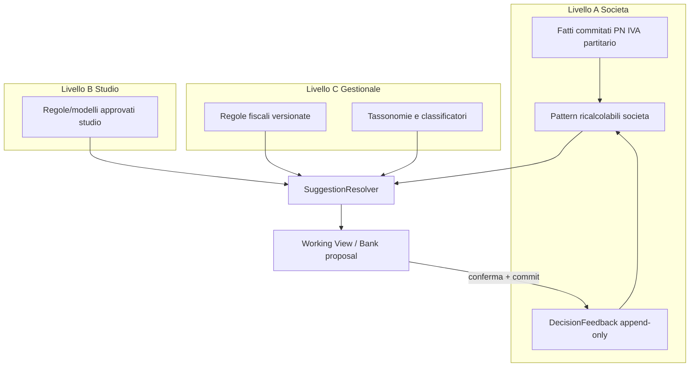

# ARCHITETTURA — Motore di apprendimento contabile (multilivello)

**Data:** 2026-10-12  
**Principio:** evolvere i motori esistenti; non creare un secondo stack parallelo.  
**Stop Fase A:** nessuna migration / persistenza nuova finché non approvata.

---

## 1. Obiettivo architetturale

Ridurre l’intervento operatore su Import fatture e Riconciliazione bancaria apprendendo **solo da decisioni confermate e commitate**, con:

- Isolamento società + tenant verificato server-side  
- Override manuale sempre prioritario  
- Spiegabilità (fonte, contesto, N precedenti, conflitti)  
- Nessuna AI che bypassi payload canonico / Stage3W / conferma  

---

## 2. Tre livelli (obbligatori)



### Livello A — Società (fonte primaria operativa)
- Chiave: `(studio_id/tenant, societa_id)` + controparte affidabile (P.IVA/CF) + direzione + **contesto economico** (categoria/descrizione normalizzata / tipo riga).
- Pattern derivati **ricalcolabili** dai fatti (PN, registri_iva, partitario) + feedback log.
- Non limitarsi al mode del fornitore: bucket almeno `controparte|direzione|categoria` (e per IVA `+|aliquota|natura`).

### Livello B — Studio
- Regole approvate esplicitamente (classificazioni, commissioni, convenzioni).
- **Vietato** propagare UUID conti di un’altra società.
- Mapping: regola studio → risoluzione conti/causali **nella** società target via codice/natura, non via id alieni.
- Distinguere `studio_rule` da `societa_history_fact`.

### Livello C — Gestionale
- Regole fiscali versionate, tassonomie, riconoscimento documentale, modelli generici movimenti (F24, POS, giroconto).
- Nessun archivio globale di fatture/IBAN/decisioni individuali.
- Condivisione statistica cross-studio: **fuori scope** (futuro + consenso).

Il sistema deve funzionare con **solo Livello A + C hardcoded/versionato**.

---

## 3. SuggestionResolver (pipeline deterministica)

Ordine fisso (classificazione contabile):

1. Scelta manuale / esplicita già presente  
2. Regola società specifica valida  
3. Storico contestuale società (controparte + tipo + contenuto)  
4. Storico generale controparte stessa società  
5. Modello studio autorizzato (Livello B)  
6. Classificazione semantica / AI **opzionale** solo se incerto e non definitiva  

IVA (già approvato, preservare):

**manuale → standard Studio contesto fiscale → storico → (AI futura)**  
Se standard ≠ storico: tenere standard + warning (già in `resolveImportWorkingViewCausaleIvaSuggestion`).

Ogni suggestion DTO:

```text
value, source, ruleId|null, contextKey, sampleCount, lastSeenAt,
conflicts[], requiresConfirmation, explanation[]
```

Niente percentuali inventate: affidabilità = funzioni di `sampleCount`, accordo mode, recenza, assenza conflitti (metriche da calibrare in test — vedi matrice).

---

## 4. Apprendimento da correzioni

### 4.1 Evento `DecisionFeedback` (concettuale — schema da approvare in Fase B)

Campi minimi:

- `societa_id`, `studio_id`, `operator_auth_user_id`  
- `source_module`: `import_contabilita` | `registrazione_manual` | `riconciliazione_bancaria`  
- `document_id` / `movement_id` / `prima_nota_id` / `request_id` (idempotenza)  
- `field`: account | causale | causale_iva | detraibilita | partita | …  
- `proposed_value`, `proposed_source`, `final_value`  
- `was_overridden`, `outcome`: confirmed | cancelled | reversed  
- `rule_version`, `context_key`, `created_at`  

Vincoli:

- Scrivere **solo post-commit riuscito** (o post-conferma esplicita bank con PN).  
- Ignorare bozze, dry-run, fixture, fail mid-commit.  
- Dedup su `(societa_id, request_id|prima_nota_id, field)`.  
- Append-only; disattivazione logica dei pattern, non delete audit.

### 4.2 Indici pattern
- Materializzati o ricalcolati offline/on-read da fatti + feedback.  
- Invalidazione su: cambio regime società, remap piano conti, storno PN collegata, regola studio nuova versione.

---

## 5. Integrazione moduli esistenti (evoluzione, non fork)

| Componente attuale | Ruolo futuro |
|---|---|
| `importContabilitaAccountingHistory.js` | Diventa adapter Livello A “conto/causale”; estendere chiavi contestuali |
| `importContabilitaVatHistory.js` | Adapter IVA; restano priorità standard>storico |
| `importContabilitaRepo` loaders | Continuano a fornire fatti; eventuale RPC scoped in seguito |
| `SuggestionResolver` (nuovo, sottile) | Unifica Import Contabilità + (progressivamente) Manuale |
| `ai_learning` / `historicalContoSuggestions` | **Deprecare come path parallelo** o adattare come sink del medesimo feedback |
| Bank `runRiconciliazioneMatch*` | Aggiungere feature “precedenti confermati” da DecisionFeedback bank |
| `fiscal-journal-history` | Resta audit commit; **non** usarlo come learning index |
| Guided templates localStorage | Opzionale bridge → regole studio (B) dopo approvazione |

---

## 6. Import fatture evoluto

Proposte (sempre non distruttive su campi già settati):

- Controparte, conto, causale, IVA/aliquota/natura, detraibilità, cespite, partita/scadenze  
- Casi speciali: NC, parcella, split, IVA cassa, reverse — tramite `contract_kind` + contesto, non mode grezzo  

Commit: invariato — payload canonico → Stage3W LAB / path autorizzato.

---

## 7. Riconciliazione evoluta

Input congiunti: movimento normalizzato, partite, PN/fatture, IBAN/descrizione, **precedenti bank confermati (A)**, regole studio (B).

Matching:

- 1:1, 1:N, N:1, parziali, ricorrenti, commissioni, POS, giroconti, F24  
- Priorità partita corretta → vietato duplicare costo su fattura già aperta  
- IVA ordinaria non da riconciliazione; IVA cassa solo via motore canonico  

UI: spiegazione score + conferma massiva **solo** proposte sopra soglia calibrata e senza conflitti; nessun commit silenzioso.

---

## 8. Sicurezza e modello dati (pre-approvazione)

Prima di nuove tabelle: valutare se bastano

- fatti esistenti (`prima_nota*`, `registri_iva`, `partitario`, `documenti_contabilita`)  
- eventuale riuso controllato di `ai_learning` **solo** se contratto allineato  

Se serve entità nuova (da approvare):

1. `contabile_decision_feedback` (append-only)  
2. Vista/funzione pattern per società (ricalcolabile)  
3. `studio_accounting_rules` (approvate, versionate)  

Per ciascuna: RLS societa/studio, no anon, API scoped come `fiscal-journal-history`, audit.

**Schema LAB applicato 20261012:** `public.contabile_decision_feedback` via `sql/security_p0/61_contabile_decision_feedback_LAB_ONLY.sql` sul volume P0 LAB pinato; accesso solo `service_role` + API scoped. Nessuna applicazione LIVE/prod.

---

## 9. Roadmap incrementale (non rompere Studio Grade)

Vedi sezione SG-L* in `ROADMAP_COMPLETAMENTO_STUDIO_GRADE.md`.

Ordine Fase B (dopo approvazione):

1. Consolida resolver + de-dup path `ai_learning`  
2. Feedback log (flag LAB) post-commit Import/Manuale  
3. Chiavi contestuali + test fornitore multi-prodotto  
4. Regole studio (B) minime  
5. Wire Bank feedback + match precedenti  
6. UI spiegazione / mass confirm gated  
7. Regressione cross-company + L6 step opzionale  
8. Metriche efficacia vs baseline attuale  

---

## 10. Criteri di accettazione architetturali

- Un solo resolver spiegabile per Import Contabilità (e percorso Manuale allineato).  
- Nessuna proposta da società B verso A.  
- Nessun apprendimento da dry-run/fail.  
- Gate L6/P3 esistenti restano verdi.  
- Baseline release: precision/correction rate non peggiori del motore mode attuale sui fixture della matrice.
